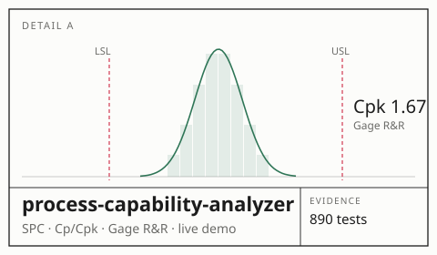
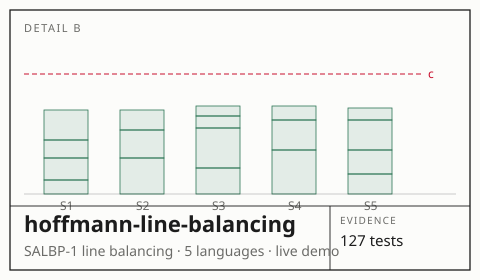
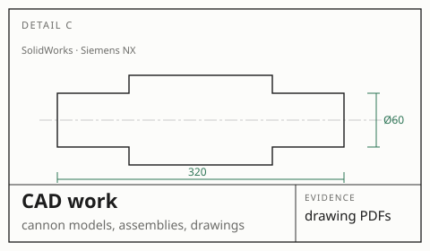
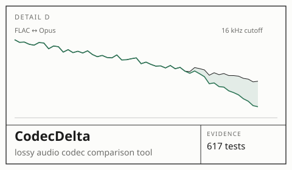
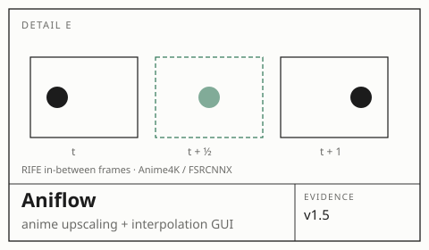
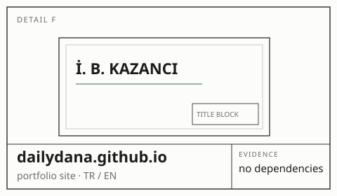
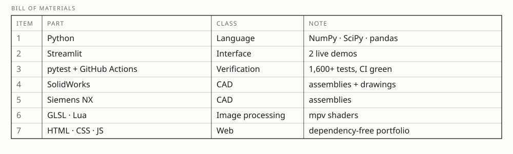

<picture>
  <source media="(prefers-color-scheme: dark)" srcset="assets/header-dark.svg">
  
</picture>

I'm a manufacturing engineer. I build tools that turn shop-floor measurements into decisions: control charts, process capability, measurement system analysis and line balancing. Each one is verified against textbook and commercial-software results.

*İmalat mühendisiyim. Üretim hattındaki ölçümden karar çıkaran araçlar yazıyorum: kontrol grafikleri, proses yeterliliği, ölçüm sistemi analizi, hat dengeleme. Her aracı ders kitabı ve ticari yazılım sonuçlarıyla birebir karşılaştırarak doğruluyorum.*

🔧 **Now:** process-capability-analyzer v0.2.0 is out (crossed Gage R&R). Next up: a design-for-manufacturability checker.

### Projects

<a href="https://github.com/DailyDana/process-capability-analyzer"><picture><source media="(prefers-color-scheme: dark)" srcset="assets/card-a-dark.svg"></picture></a>
<a href="https://github.com/DailyDana/hoffmann-line-balancing"><picture><source media="(prefers-color-scheme: dark)" srcset="assets/card-b-dark.svg"></picture></a>
<a href="https://dailydana.github.io/projeler/cad-calismalari/"><picture><source media="(prefers-color-scheme: dark)" srcset="assets/card-c-dark.svg"></picture></a>
<a href="https://github.com/DailyDana/CodecDelta"><picture><source media="(prefers-color-scheme: dark)" srcset="assets/card-d-dark.svg"></picture></a>
<a href="https://github.com/DailyDana/Aniflow"><picture><source media="(prefers-color-scheme: dark)" srcset="assets/card-e-dark.svg"></picture></a>
<a href="https://dailydana.github.io"><picture><source media="(prefers-color-scheme: dark)" srcset="assets/card-f-dark.svg"></picture></a>

Live demos: [SPC analyzer](https://spc-analyzer.streamlit.app) · [line balancing](https://hoffmann-line-balancing.streamlit.app)

### Toolbox

             

<picture>
  <source media="(prefers-color-scheme: dark)" srcset="assets/bom-dark.svg">
  
</picture>

---

[dailydana.github.io](https://dailydana.github.io) · [LinkedIn](https://linkedin.com/in/ismailbilgehankazanci) · bilgehankazanci@gmail.com
